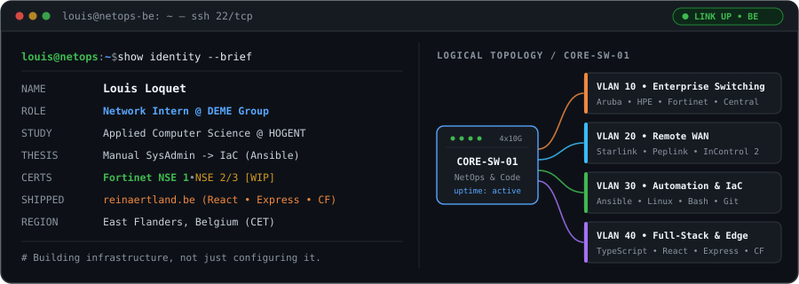

  

Applied Computer Science student at **HOGENT** and Network Intern at **DEME Group**. I spend most of my time where **enterprise networking, Linux, and automation** meet — standardizing switch infrastructure, automating systems with Ansible, and shipping full-stack web tools when an organization needs one.

---

### Selected Work

<table>
  <tr>
    <td width="50%" valign="top">
      <strong><a href="https://github.com/LouisLoquet/Gewest-Reinaertland-Portal">Gewest-Reinaertland-Portal</a></strong> &nbsp;<code>LIVE</code> 
      Production site &amp; operations portal at <a href="https://reinaertland.be">reinaertland.be</a>
        
      Full-stack platform for 9 regional Chiro groups: RBAC dashboard, dynamic registration forms with SEPA/Payconiq QR payments, treasury ledgers, two-way Google Calendar OAuth2 sync, browser-side WebP compression, and full OWASP security hardening.
        
      <code>React 19</code> <code>TypeScript</code> <code>Express</code> <code>Turso/LibSQL</code> <code>Cloudflare</code>
    </td>
    <td width="50%" valign="top">
      <strong>Enterprise Network Governance</strong> &nbsp;<code>DEME GROUP</code> 
      Internship — Enterprise Infrastructure Team
        
      Hands-on work inside a large enterprise switching &amp; security environment: switch inventory and lifecycle tracking, topology documentation, Aruba Central migration readiness, Fortinet firewall operations, and configuration standardization.
        
      <code>Aruba</code> <code>HPE</code> <code>Fortinet</code> <code>Aruba Central</code> <code>HPE IMC</code> <code>Visio</code>
    </td>
  </tr>
  <tr>
    <td width="50%" valign="top">
      <strong>Starlink &amp; Peplink Remote WAN</strong> &nbsp;<code>CONNECTIVITY</code> 
      Multi-site remote connectivity &amp; asset analysis
        
      Inventory and cross-source asset reconciliation for Starlink Residential &amp; Mini deployments paired with Peplink WAN infrastructure — covering InControl 2 analysis, standardization, and remote diagnostics.
        
      <code>Starlink</code> <code>Peplink</code> <code>InControl 2</code> <code>WAN</code> <code>Troubleshooting</code>
    </td>
    <td width="50%" valign="top">
      <strong><a href="https://github.com/LouisLoquet/Bachelorproef_25-26-LL">Manual SysAdmin → Infrastructure as Code</a></strong> &nbsp;<code>THESIS</code> 
      <a href="https://github.com/LouisLoquet/Bachelorproef_25-26-LL">Bachelor's Thesis — HOGENT Applied Computer Science</a>
        
      Research and implementation moving from ad-hoc manual server administration to version-controlled, reproducible configuration management across both Linux and Windows environments using Ansible roles and playbooks.
        
      <code>Ansible</code> <code>Linux</code> <code>Windows</code> <code>YAML</code> <code>Git</code>
    </td>
  </tr>
</table>

---

### Technical Stack

| Domain | Technologies & Tools |
| :--- | :--- |
| **Networking** | Aruba, HPE, Cisco, Fortinet, Peplink, Starlink · Switching, VLANs, Routing, WAN, Troubleshooting |
| **Network Management** | Aruba Central, HPE IMC, Peplink InControl 2, Microsoft Visio |
| **Systems & Automation** | Linux, Windows Server, Ansible, Infrastructure as Code, Bash, PowerShell, Git, YAML |
| **Web, Edge & Security** | TypeScript, React 19, Node.js, Express, Tailwind CSS, Turso / LibSQL, Cloudflare, Render |

---

### Credentials & Links

| Certification / Link | Status / Details |
| :--- | :--- |
| **Fortinet NSE 1** — Network Security Associate | [Verified on Credly](https://www.credly.com/badges/64893932-b7eb-44d7-9093-cc49bbaff04d/public_url) |
| **Fortinet NSE 2 & NSE 3** | In progress |
| **Education** | Bachelor in Applied Computer Science — HOGENT |
| **Links** | [LinkedIn](https://www.linkedin.com/in/louis-loquet/) &nbsp;·&nbsp; [Credly](https://www.credly.com/users/louis-loquet/badges/) &nbsp;·&nbsp; [reinaertland.be](https://reinaertland.be) &nbsp;·&nbsp; [Gewest-Reinaertland-Portal](https://github.com/LouisLoquet/Gewest-Reinaertland-Portal) |
